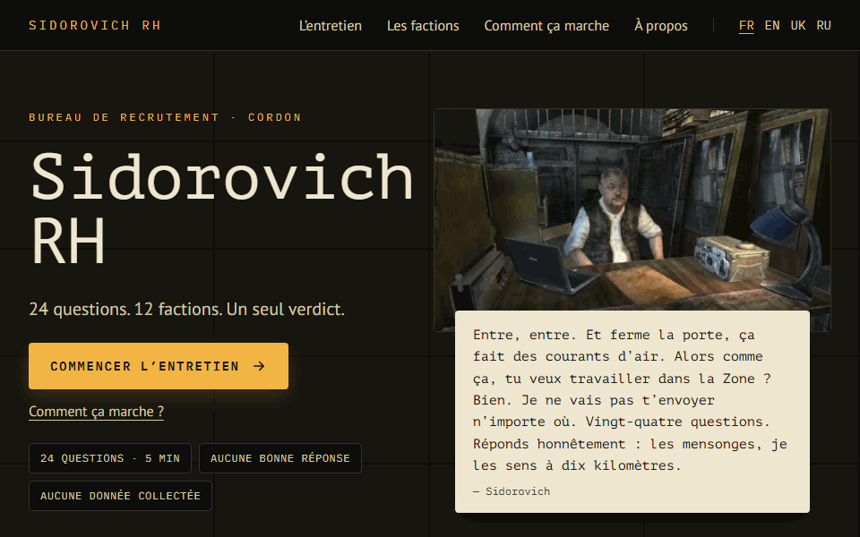
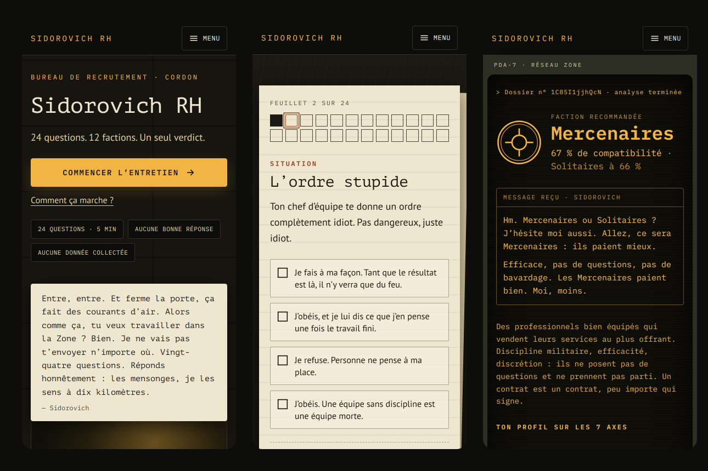
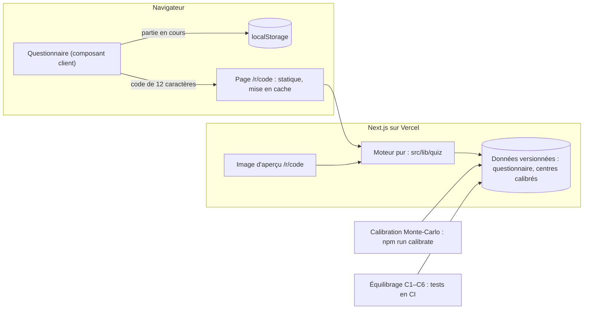

# Sidorovich RH

> Entretien d'embauche dans la Zone : réponds aux 24 questions de Sidorovich et découvre laquelle des 12 factions de l'univers _S.T.A.L.K.E.R._ est faite pour toi.

**[sidorovich.vercel.app](https://sidorovich.vercel.app)** · en français, English, українська, русский.



**Statut :** phase 7 du [plan de développement](docs/03-plan-de-developpement.md) (qualité et lancement). Le test est complet et habillé ; restent la vidéo de fond du bunker et la recette finale avant la `v1.0.0`.

## Ce que montre le projet

- **Un moteur de score testé** : fonctions pures en TypeScript, 7 axes de valeurs, distance aux centres de 12 factions. Les centres sont calibrés par simulation de Monte-Carlo, avec une graine fixe.
- **Un équilibrage mesuré** : six critères chiffrés (C1 à C6), vérifiés par la CI à chaque modification du questionnaire.
- **Un partage sans base de données** : les 24 réponses tiennent dans un code de 12 caractères, avec somme de contrôle et numéro de version. Tout lien partagé reste lisible quand le questionnaire évolue.
- **Next.js 16 au plus près de la plateforme** :
  - pages statiques ; les résultats sont rendus à la première visite puis mis en cache (`ensureStatic`) ;
  - images d'aperçu générées par résultat et par langue ;
  - aucun secret et aucune base de données.
- **4 langues**, avec des textes complets et des tests de cohérence entre catalogues (clés, variables, typographie).
- **Accessibilité et qualité** :
  - 0 violation axe-core (WCAG 2.1 AA) ;
  - parcours complet au clavier et prise en compte de la réduction des animations ;
  - tests de bout en bout sur 5 navigateurs ;
  - Lighthouse ≥ 92 en performance, 100 en accessibilité.
- **Une direction artistique sans image** : béton, papier et écran dessinés en CSS, 12 emblèmes SVG originaux, animations en CSS uniquement.



## Architecture



| Dossier           | Contenu                                                                 |
| ----------------- | ----------------------------------------------------------------------- |
| `src/lib/quiz/`   | Moteur : profil, distances, encodage des codes, simulation, équilibrage |
| `src/data/`       | Questionnaire v1 (deltas), profils des factions, centres calibrés       |
| `src/app/`        | Pages par langue, images d'aperçu, sitemap, robots, manifest            |
| `src/components/` | Bunker, dossier, PDA, emblèmes, navigation                              |
| `src/messages/`   | Textes des 4 langues                                                    |
| `tests/`, `e2e/`  | Vitest (unitaires, propriétés, équilibrage) et Playwright               |

## Moteur de score

1. Chaque réponse déplace le profil du candidat sur **7 axes de valeurs** (de −2 à +2 points).
2. Le profil est ramené dans [−1, 1]⁷ avec des bornes asymétriques : chaque pôle de chaque axe reste atteignable.
3. Il est comparé par distance euclidienne aux **centres calibrés** des 12 factions. Compatibilité = 100 × (1 − d ÷ √7).
4. Les centres viennent d'une **simulation de candidats** : 3 000 par faction, avec bruit gaussien et choix probabilistes.
5. Si les deux premières factions sont à moins de 3 points, le résultat est **hybride** et Sidorovich hésite.

Le détail des questions et de leur impact sur chaque faction est dans le [document 02](docs/02-questionnaire.md), généré depuis le code.

## Équilibrage

Mesures du `npm run balance` (questionnaire v1) :

| Critère                                     | Seuil                       | Mesure              |
| ------------------------------------------- | --------------------------- | ------------------- |
| C1 · Chaque faction reconnaît son archétype | 12/12                       | 12/12               |
| C2 · Chaque faction est atteignable         | ≥ 80 % et 1re               | min 94 %            |
| C3 · Un candidat proche retrouve sa faction | ≥ 65 % chacune, ≥ 80 % moy. | min 70 %, moy. 85 % |
| C4 · Répartition des réponses au hasard     | entre 2 % et 25 %           | de 3,6 % à 21,5 %   |
| C5 · Questions par axe                      | ≥ 8                         | min 8               |
| C6 · Aucune réponse sans effet              | 24/24                       | 24/24               |

## Qualité

| Mesure                                     | Résultat                                                                                                 |
| ------------------------------------------ | -------------------------------------------------------------------------------------------------------- |
| Lighthouse mobile (perf · a11y · BP · SEO) | Accueil 98 · 100 · 100 · 100 ; questionnaire 92 · 100 · 100 · 100 ; résultat 95 · 100 · 100 · 100        |
| Core Web Vitals (laboratoire)              | LCP 2,1 à 2,6 s · CLS ≤ 0,06 · TBT ≤ 230 ms                                                              |
| JavaScript compressé                       | 161 à 164 Ko par page (budget : 200 Ko)                                                                  |
| Accessibilité                              | 0 violation axe-core (WCAG 2.1 AA), parcours au clavier testé                                            |
| Tests                                      | Vitest : unitaires, propriétés (fast-check), équilibrage ; couverture du moteur ≥ 97 %                   |
| Navigateurs                                | Chrome, Firefox, Safari (WebKit), Chrome Android, Safari iOS                                             |
| Sécurité                                   | CSP, HSTS, `nosniff`, `Referrer-Policy`, `Permissions-Policy` ; Dependabot ; 0 vulnérabilité `npm audit` |

Les mesures Lighthouse sont faites en local, sur un build de production (`npm run lighthouse`, médiane de 3 passages). Le résultat mesuré est un « dossier type » ; les autres résultats sont volontairement exclus de l'indexation.

## Démarrer

Node.js 22 ou plus récent, avec un npm récent (11.19 ou plus, livré avec Node 24) : npm 11.6 écrit un `package-lock.json` que la CI refuse.

```bash
npm install
npm run dev
```

Puis ouvrir <http://localhost:3000>. Aucune variable d'environnement n'est nécessaire.

| Commande                     | Rôle                                                                  |
| ---------------------------- | --------------------------------------------------------------------- |
| `npm run dev`                | Serveur de développement                                              |
| `npm run build`              | Build de production (précédé de `validate`)                           |
| `npm run lint`               | ESLint                                                                |
| `npm run format`             | Prettier (`format:check` pour vérifier sans écrire)                   |
| `npm run typecheck`          | Génère les types de routes puis vérifie TypeScript                    |
| `npm test`                   | Tests (Vitest) ; `test:coverage` avec la couverture                   |
| `npm run test:e2e`           | Tests de bout en bout (Playwright), après `npm run build`             |
| `npm run validate`           | Vérifie la cohérence des données du questionnaire                     |
| `npm run calibrate`          | Recalcule les centres des factions après une modification             |
| `npm run balance`            | Rapport d'équilibrage du questionnaire (critères C1 à C6)             |
| `npm run docs:questionnaire` | Régénère `docs/02-questionnaire.md`                                   |
| `npm run icons`              | Régénère les icônes PNG et le favicon depuis `src/app/icon.svg`       |
| `npm run lighthouse`         | Mesure Lighthouse des pages clés (voir l'en-tête du script)           |
| `npm run demo`               | Régénère la capture animée et les captures mobiles du README          |
| `npm run check`              | Tout ce que la CI vérifie, sauf le build et les tests de bout en bout |

Avant le premier `npm run test:e2e`, installer les navigateurs des tests : `npx playwright install chromium firefox webkit`.

Une surcharge (`overrides` dans `package.json`) impose `minimatch` ≥ 11.0.1 sous `typescript-eslint` : la dernière version de ce dernier dépend encore d'une version vulnérable (avis GHSA-g3hv-75wg-m249).

## Documentation

- [Cahier des charges](docs/01-cahier-des-charges.md)
- [Questionnaire et impacts par faction](docs/02-questionnaire.md), généré depuis les données
- [Plan de développement](docs/03-plan-de-developpement.md)
- [Protocole de playtest](docs/04-playtest.md)
- [Direction artistique](docs/05-direction-artistique.md)

## Licence et mentions

Code, textes et visuels originaux sous [licence MIT](LICENSE). Les polices PT Mono (ParaType) et IBM Plex Mono (IBM), embarquées dans `assets/fonts/` pour les images d'aperçu, sont sous licence SIL Open Font License 1.1 (textes joints).

Projet de fan non officiel, non affilié à GSC Game World. _S.T.A.L.K.E.R._ et les noms de son univers sont des marques de GSC Game World et ne sont pas couverts par cette licence. Le projet suit les [conditions de GSC Game World pour les créations de fans](https://gsc-game.com/guidelines) (analyse dans le [cahier des charges, § 13.4](docs/01-cahier-des-charges.md)).
