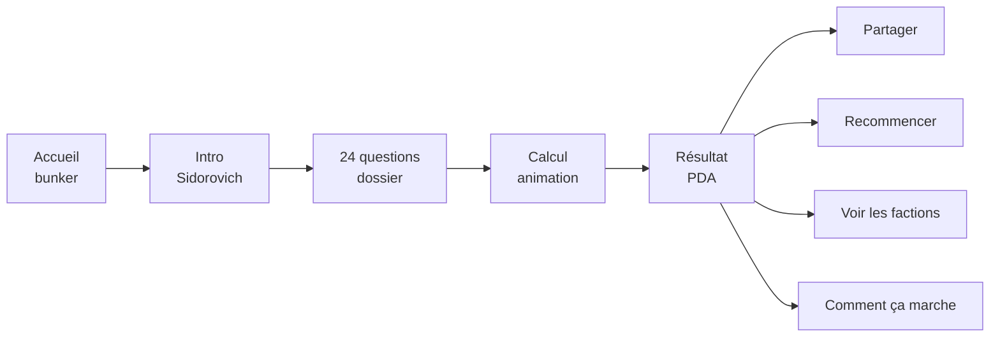

# 01 · Cahier des charges

> **Projet :** Sidorovich RH, test de personnalité « Quelle faction de la Zone est faite pour toi ? » (nom de travail)
> **Projet de :** Lilian Brossard · **Dépôt :** [LilianBrossard/Sidorovich](https://github.com/LilianBrossard/Sidorovich) · **Hébergement :** Vercel
> **Version :** 0.1, brouillon du 15/11/2026, à valider
> **Documents liés :** [02 · Questionnaire et impacts](02-questionnaire.md) · [03 · Plan de développement](03-plan-de-developpement.md)

Ce document fixe **ce que le site doit faire et comment on vérifie qu'il le fait**. Chaque exigence porte un identifiant, un critère de validation mesurable et une priorité :

| Priorité | Sens |
|---|---|
| **Indispensable** | Bloque la mise en ligne de la V1 si elle n'est pas remplie. |
| **Important** | Attendu en V1. Peut être reporté seulement par décision explicite, notée dans ce document. |
| **Souhaitable** | Bonus en V1 si le temps le permet, sinon reporté. |
| **V2** | Prévu après le lancement. |

---

## 1. Contexte et objectifs

### 1.1 Contexte

Projet personnel de fan, destiné au portfolio de Lilian Brossard. Il s'appuie sur l'univers de la série de jeux *S.T.A.L.K.E.R.* (GSC Game World) : la trilogie *Shadow of Chernobyl*, *Clear Sky* et *Call of Pripyat*, puis *S.T.A.L.K.E.R. 2: Heart of Chornobyl*.

### 1.2 Concept

Sidorovich, le marchand bourru du Cordon, s'improvise **recruteur**. Le visiteur passe un « entretien d'embauche » dans son bunker. Il répond à **24 questions** : des dilemmes moraux, des questions de société, des affirmations à évaluer. La plupart n'ont rien à voir avec le jeu. À la fin, Sidorovich ouvre son PDA et annonce la faction où il « l'envoie travailler », parmi **12 factions**, avec un pourcentage de compatibilité pour chacune.

### 1.3 Objectifs

| ID | Objectif | Indicateur |
|---|---|---|
| O1 | **Vitrine technique** pour le portfolio : logique (moteur de score testé et équilibré), visuel (direction artistique narrative, animations), ingénierie (4 langues, CI/CD, performances, accessibilité). | Toutes les exigences *Indispensable* validées ; README illustré expliquant l'architecture et le moteur. |
| O2 | **Expérience courte et prenante.** | Durée médiane d'un test : 6 à 8 min, mesurée en playtest. Taux de complétion ≥ 60 %, mesuré par le rapport entre vues de la page résultat et vues du questionnaire. |
| O3 | **Résultat partageable.** | Chaque résultat a une URL unique et une image d'aperçu propre sur Discord, X, Facebook et LinkedIn. |
| O4 | **Compréhensible en 30 secondes** par un recruteur qui visite le portfolio. | Une page « Comment ça marche » explique le modèle en moins de 600 mots, avec un schéma. |

---

## 2. Périmètre

### 2.1 V1, le lancement

- Questionnaire de 24 questions en 4 langues : français, anglais, ukrainien, russe.
- Moteur de score à 7 axes et 12 factions, détaillé dans le [document 02](02-questionnaire.md).
- Résultat détaillé, partageable par URL, avec image d'aperçu générée dynamiquement.
- Pages annexes : les factions, comment ça marche, à propos et mentions, erreur 404.
- Direction artistique en trois scènes : bunker, dossier, PDA.
- **Aucune base de données**, aucun compte utilisateur.

### 2.2 V2, après le lancement

- Statistiques globales anonymes, par exemple « 18 % des candidats finissent au Devoir ».
- Comparaison de deux résultats (« compare-toi à un ami »).
- Easter egg.

### 2.3 Hors périmètre

- Comptes, connexion, collecte de données personnelles.
- Monétisation, publicité.
- Application mobile native.
- Tout asset officiel des jeux : images, logos, musiques, sons, polices.
- Toute référence à des conflits, partis, religions ou personnalités politiques réels.

---

## 3. Publics et parcours

### 3.1 Publics

1. **Joueurs de S.T.A.L.K.E.R.**, francophones, anglophones, ukrainophones et russophones. Ils attendent des clins d'œil fidèles à l'univers.
2. **Amateurs de tests de personnalité** qui ne connaissent pas le jeu. Ils doivent comprendre sans contexte, d'où les questions universelles.
3. **Recruteurs et visiteurs du portfolio.** Ils doivent voir la technique, d'où la page « Comment ça marche » et le README.

### 3.2 Parcours principal

---

## 4. Exigences fonctionnelles

### 4.1 Accueil et navigation

| ID | Exigence | Critère de validation | Priorité |
|---|---|---|---|
| F-01 | L'accueil présente le concept et propose de commencer. | Le bouton « Commencer » est visible sans défilement sur un écran de 360 × 640 px. | Indispensable |
| F-02 | Un sélecteur de langue est accessible depuis toutes les pages. | Changer de langue en plein questionnaire conserve la progression et la question en cours. | Indispensable |
| F-03 | Un pied de page commun porte la mention fan (voir L-01) et les liens annexes. | Présent sur 100 % des pages. | Indispensable |

### 4.2 Questionnaire

| ID | Exigence | Critère de validation | Priorité |
|---|---|---|---|
| F-10 | 24 questions, une par écran, de deux types : choix parmi 4 réponses, ou échelle d'accord à 5 niveaux. | Conforme au [document 02](02-questionnaire.md). | Indispensable |
| F-11 | L'ordre des réponses est mélangé à chaque partie, mais reste stable pendant la partie (retour arrière, rechargement). | Deux parties ont des ordres différents ; revenir sur une question montre le même ordre. | Indispensable |
| F-12 | La progression est visible. | Compteur « n / 24 » et barre de progression à chaque question. | Indispensable |
| F-13 | Retour à la question précédente et modification d'une réponse. | Possible pour les 23 questions précédentes ; le résultat tient compte de la dernière réponse donnée. | Indispensable |
| F-14 | Reprise après rechargement ou fermeture de l'onglet. | La progression est restaurée depuis le stockage local du navigateur ; un bouton « Recommencer » la réinitialise. | Important |
| F-15 | Navigation complète au clavier. | Touches 1 à 4 (ou 1 à 5), flèches, Entrée, Retour arrière ; focus toujours visible. | Indispensable |
| F-16 | Sidorovich s'exprime par écrit (aucune voix enregistrée) : intro, mi-parcours, réactions ponctuelles, verdict. | Au moins 8 questions ont une réplique de réaction ; texte affiché avec un effet de frappe qu'on peut passer en un clic. | Important |

### 4.3 Résultat

| ID | Exigence | Critère de validation | Priorité |
|---|---|---|---|
| F-20 | Affichage de la faction attribuée : emblème, nom, % de compatibilité, verdict de Sidorovich, description. | Les 12 factions ont leur contenu complet dans les 4 langues. | Indispensable |
| F-21 | Radar à 7 branches : profil du candidat superposé à celui de la faction. | Rendu SVG, lisible de 320 px à 1920 px de large, avec une alternative textuelle pour les lecteurs d'écran. | Indispensable |
| F-22 | Classement des 12 factions avec leur pourcentage. | Trié par compatibilité décroissante ; total des 12 lignes affiché. | Indispensable |
| F-23 | Explication par axe : une phrase décrit la position du candidat (par exemple « Tu penches nettement vers l'ordre »). | 7 phrases générées à partir de seuils documentés. | Important |
| F-24 | Résultat hybride : si l'écart entre la 1re et la 2e faction est inférieur à 3 points, Sidorovich hésite entre les deux, puis tranche. | Testé par un cas unitaire et un test de bout en bout. | Important |
| F-25 | URL de résultat partageable, sans base de données : les réponses et la version du questionnaire sont encodées dans l'URL. | Ouvrir le lien sur un autre appareil affiche exactement le même résultat. Code de 16 caractères au maximum. Un code altéré affiche une erreur propre, jamais une page cassée. | Indispensable |
| F-26 | Les anciens liens restent valides quand le questionnaire évolue. | Le décodeur gère toutes les versions publiées. Une version retirée affiche un message et invite à refaire le test. | Important |
| F-27 | Boutons de partage : partage natif du téléphone quand il existe, copie du lien sinon. | Fonctionne sur iOS Safari, Android Chrome et les navigateurs de bureau. | Indispensable |
| F-28 | Image d'aperçu dynamique (Open Graph, 1200 × 630) par résultat et par langue : emblème, faction, %, mini-radar. | Validée dans les outils d'aperçu de Discord, X, Facebook et LinkedIn. | Indispensable |

### 4.4 Pages annexes

| ID | Exigence | Critère de validation | Priorité |
|---|---|---|---|
| F-30 | Page « Les factions » : 12 fiches avec nom, emblème, idéologie, signature sur les axes. | 12 fiches × 4 langues. | Important |
| F-31 | Page « Comment ça marche » : les axes, la distance, la calibration, les tests d'équilibrage. | Moins de 600 mots, au moins un schéma, lien vers le code. | Indispensable |
| F-32 | Page « À propos » : mentions légales, crédits, licence, avertissement fan. | Conforme à la section 10. | Indispensable |
| F-33 | Page 404 dans l'univers (« Tu t'es perdu dans une anomalie… »). | Toute URL inconnue y mène, dans la bonne langue. | Important |

### 4.5 Bonus et V2

| ID | Exigence | Critère de validation | Priorité |
|---|---|---|---|
| F-40 | Ambiance sonore optionnelle : grésillements, tampon, compteur Geiger. Aucune voix. | Coupée par défaut ; bouton son visible ; 300 Ko au total au maximum. | Souhaitable |
| F-41 | Easter egg (combinaison de réponses ou interaction cachée). | Documenté dans le code, absent du README. | Souhaitable |
| F-42 | Statistiques globales anonymes et page de répartition. | Comptage par faction, limitation de débit, aucune donnée personnelle stockée. | V2 |
| F-43 | Comparaison de deux résultats : radars superposés et distance entre les deux profils. | URL `…/compare/{code1}/{code2}`. | V2 |

---

## 5. Modèle de score

### 5.1 Principe

Le modèle complet et les 24 questions sont dans le [document 02](02-questionnaire.md). En résumé :

1. Chaque réponse déplace le profil du candidat sur **7 axes de valeurs** : Ordre ↔ Liberté, Altruisme ↔ Intérêt personnel, Collectif ↔ Indépendance, Foi ↔ Raison, Force ↔ Non-violence, Respect ↔ Maîtrise de l'inconnu, Idéalisme ↔ Pragmatisme.
2. Le profil est normalisé entre −1 et +1 sur chaque axe.
3. Il est comparé au **centre calibré** de chacune des 12 factions par distance euclidienne.
4. Compatibilité = 100 × (1 − distance / √7).

### 5.2 Exigences

| ID | Exigence | Critère de validation | Priorité |
|---|---|---|---|
| S-01 | Le moteur est une fonction pure (réponses → résultat), sans accès au DOM, au réseau ni à l'horloge. | Couverture de tests ≥ 90 % des lignes du module moteur. | Indispensable |
| S-02 | Les données du questionnaire sont validées par un schéma à la compilation. | Le build échoue si une question n'a pas 4 réponses (ou 5 niveaux), si un delta sort de [−2, 2] ou si un texte manque dans une langue. | Indispensable |
| S-03 | La calibration des centres est reproductible. | Script `npm run calibrate` à graine fixe ; deux exécutions donnent le même fichier ; le fichier est versionné. | Indispensable |
| S-04 | Toute modification des deltas ou des questions crée une nouvelle version du questionnaire. | Un test vérifie que les données d'une version publiée n'ont pas changé (empreinte stockée). | Important |
| S-05 | Les mêmes réponses donnent toujours le même résultat, sur le serveur comme dans le navigateur. | Test de propriété : `décoder(encoder(réponses)) = réponses` et le résultat est identique des deux côtés. | Indispensable |

### 5.3 Critères d'équilibrage

Ils sont exécutés en intégration continue. **Un échec bloque la fusion.** Les valeurs actuelles du prototype figurent dans le [document 02, section 7](02-questionnaire.md#7-synthèse-et-équilibrage).

| ID | Critère | Seuil |
|---|---|---|
| C1 | Un candidat qui répond « comme » une faction obtient cette faction. | 12 factions sur 12 |
| C2 | Chaque faction est atteignable en tête du classement. | Score maximal ≥ 80 % pour chaque faction |
| C3 | Reconnaissance : des personas proches d'une faction (bruit σ = 0,3) obtiennent cette faction. | ≥ 65 % pour chaque faction et ≥ 80 % en moyenne |
| C4 | Répartition : sur 20 000 personas aux convictions aléatoires, aucune faction n'est introuvable ni écrasante. | Chaque faction obtient entre 2 % et 25 % des résultats |
| C5 | Couverture des axes. | Chaque axe est touché par au moins 8 questions |
| C6 | Aucune réponse sans effet, hors « Sans avis ». | 100 % des réponses |

---

## 6. Contenu et narration

| ID | Exigence | Critère de validation | Priorité |
|---|---|---|---|
| N-01 | Ton de Sidorovich : bourru, sarcastique, mercantile. Il se moque gentiment du candidat, sans jamais l'insulter. | Aucune grossièreté ; relecture du ton sur toutes les répliques. | Indispensable |
| N-02 | Questions universelles, compréhensibles sans connaître le jeu. | Au plus 4 questions sur 24 citent un élément de l'univers (Zone, émission…). | Important |
| N-03 | Aucune référence à des événements, conflits, partis, religions ou personnalités réels. | Relecture dédiée avant le lancement. | Indispensable |
| N-04 | Formulations épicènes : le candidat peut être une candidate. En ukrainien et en russe, on privilégie le présent pour éviter les accords de genre du passé. | Relecture dédiée dans chaque langue. | Important |
| N-05 | Textes courts. | Question ≤ 220 caractères et réponse ≤ 80 caractères en français ; marge de +35 % prévue dans la mise en page pour les autres langues. | Important |
| N-06 | Textes originaux : fiches factions et répliques écrites pour le projet, aucune reprise de dialogues du jeu ni de wikis. | Relecture avant le lancement. | Indispensable |
| N-07 | Le test se présente comme un divertissement, pas comme une évaluation psychologique. | Mention sur l'accueil et sur la page « Comment ça marche ». | Indispensable |

---

## 7. Internationalisation

| ID | Exigence | Critère de validation | Priorité |
|---|---|---|---|
| I-01 | 4 langues : `fr` (langue source), `en`, `uk`, `ru`, avec un préfixe d'URL (`/fr/…`, `/en/…`, `/uk/…`, `/ru/…`). | Toutes les pages existent dans les 4 langues. | Indispensable |
| I-02 | Première visite : langue détectée depuis le navigateur (`Accept-Language`), jamais depuis la géolocalisation. Le choix manuel est mémorisé. | Test de bout en bout avec chaque langue de navigateur ; repli sur l'anglais. | Indispensable |
| I-03 | Toutes les chaînes sont traduites dans les 4 langues. | Un test échoue si une clé manque ou est vide dans une langue. | Indispensable |
| I-04 | Les polices couvrent le latin et le cyrillique, y compris les lettres ukrainiennes ї, є, і, ґ. | Page de test typographique validée visuellement. | Indispensable |
| I-05 | La mise en page tolère des textes jusqu'à 35 % plus longs que le français. | Aucun débordement dans les tests visuels en `ru` et `uk`. | Important |
| I-06 | Attributs `lang` et `hreflang` corrects ; nombres formatés selon la langue (« 86 % » en français, « 86% » en anglais). | Validé par un audit SEO et des tests unitaires de formatage. | Important |
| I-07 | Les traductions UK et RU sont relues par un locuteur natif avant le lancement. | Nom du relecteur dans les crédits. À défaut, la page « À propos » mentionne une traduction assistée. | Important |
| I-08 | Le sélecteur affiche chaque langue dans sa propre langue : Français, English, Українська, Русский. | Conforme. | Indispensable |

**Glossaire des noms propres** (vérifié en phase 3 ; à confirmer contre les localisations officielles lors de la relecture native) :

| FR | EN | UK | RU |
|---|---|---|---|
| Solitaires | Loners | Одинаки | Одиночки |
| Devoir | Duty | Обов'язок | Долг |
| Liberté | Freedom | Свобода | Свобода |
| Bandits | Bandits | Бандити | Бандиты |
| Mercenaires | Mercenaries | Найманці | Наёмники |
| Monolithe | Monolith | Моноліт | Монолит |
| Écologistes | Ecologists | Екологи | Экологи |
| Militaires | Military | Військові | Военные |
| Clear Sky | Clear Sky | Чисте Небо | Чистое Небо |
| Ward (« la Garde » dans la VF de S2, d'après une seule source) | Ward | Варта | Варта |
| Spark | Spark | Іскра | Искра |
| Noon | Noon | Полудень | Полдень |
| Sidorovich | Sidorovich | Сидорович | Сидорович |
| la Zone | the Zone | Зона | Зона |
| Tchernobyl | Chornobyl | Чорнобиль | Чернобыль |

---

## 8. Direction artistique

### 8.1 Trois scènes, une histoire

| Scène | Écran | Intention |
|---|---|---|
| **Bunker** | Accueil, intro, transitions | Sous-sol sombre, lampe qui vacille, comptoir encombré. Sidorovich apparaît **en silhouette, à contre-jour** : on devine la carrure, les mains, la fumée, jamais le visage. Ce parti pris évite de reproduire le personnage officiel et renforce le mystère. |
| **Dossier** | Questionnaire | Formulaire de recrutement d'inspiration soviétique : papier jauni, tampons, numéro de dossier, trombone, typographie de machine à écrire. Une réponse coche une case ; la dernière question se valide d'un coup de tampon. |
| **PDA** | Calcul et résultat | Écran rétro de stalker : lignes de balayage, lueur ambre ou verte, démarrage animé, radar qui se dessine, emblème de la faction. |

### 8.2 Exigences

| ID | Exigence | Critère de validation | Priorité |
|---|---|---|---|
| V-01 | Charte graphique sous forme de *design tokens* : couleurs (rouille, kaki, papier, ambre), typographies, espacements, ombres. | Un fichier unique de tokens ; aucune couleur codée en dur dans les composants. | Indispensable |
| V-02 | Contrastes conformes WCAG AA, y compris sur les textures (papier, écran). | Ratio ≥ 4,5:1 pour le texte courant, mesuré. | Indispensable |
| V-03 | 12 emblèmes de faction **originaux** en SVG. Ils peuvent reprendre les couleurs ou l'esprit d'une faction, jamais copier un logo officiel. | Relecture avant le lancement. | Indispensable |
| V-04 | Maquettes des 3 scènes, sur mobile et sur ordinateur, validées avant l'intégration. | 6 maquettes validées par Lilian. | Important |
| V-05 | Animations fluides. | 60 images par seconde sur un téléphone milieu de gamme, mesuré avec l'outil Performance du navigateur. | Important |
| V-06 | Respect de `prefers-reduced-motion`. | Animations décoratives désactivées, transitions réduites à des fondus. | Indispensable |
| V-07 | Responsive de 360 px à 1920 px, conçu d'abord pour le mobile. | Aucun défilement horizontal ; tests à 360, 768, 1280 et 1920 px. | Indispensable |

---

## 9. Exigences techniques

### 9.1 Pile technique retenue

| Domaine | Choix | Raison |
|---|---|---|
| Framework | **Next.js** (dernière version stable au démarrage, App Router) + **TypeScript** strict | Demandé ; rendu statique et serveur, génération d'images d'aperçu intégrée, hébergement Vercel natif. |
| Style | **Tailwind CSS**, avec les design tokens en variables CSS | Rapide, cohérent, sans CSS mort. |
| Animations | **Motion** (ex-Framer Motion) | Transitions de page et animations déclaratives, gestion de la réduction des animations. |
| i18n | **next-intl** | Routage par langue, messages typés, formatage `Intl`. |
| Validation | **Zod** | Schéma des données du questionnaire et des codes de résultat. |
| Graphique radar | **SVG maison** | Léger, animable, et démontre la compétence. Pas de bibliothèque de graphiques. |
| Images d'aperçu | `next/og` (`ImageResponse`) | Génération dynamique par résultat et par langue. |
| Tests | **Vitest** (unitaires, propriétés avec fast-check), **Playwright** (bout en bout), axe-core (accessibilité) | Couvre la logique, le parcours et l'accessibilité. |
| CI/CD | **GitHub Actions** + **Vercel** (aperçu par PR, production sur `main`) | Gratuit et standard. |

### 9.2 Exigences

| ID | Exigence | Critère de validation | Priorité |
|---|---|---|---|
| T-01 | Pages de contenu pré-rendues (statiques) dans les 4 langues ; page résultat rendue à la demande puis mise en cache. | Vérifié dans la sortie de `next build`. | Indispensable |
| T-02 | Aucune base de données, aucun secret requis en V1. | Le projet se lance avec `npm install && npm run dev`, sans fichier `.env`. | Indispensable |
| T-03 | Performances, mesurées avec Lighthouse mobile sur l'accueil, le questionnaire et le résultat. | Performance ≥ 90 ; Accessibilité, Bonnes pratiques et SEO ≥ 95. | Indispensable |
| T-04 | Core Web Vitals dans le vert. | LCP ≤ 2,5 s, CLS ≤ 0,1, INP ≤ 200 ms. | Indispensable |
| T-05 | Budget JavaScript. | ≤ 200 Ko compressés chargés sur la page questionnaire, hors images et sons. | Important |
| T-06 | Accessibilité WCAG 2.1 AA. | 0 violation axe-core sur les pages principales ; parcours complet réalisable au clavier et avec NVDA ou VoiceOver. | Indispensable |
| T-07 | Compatibilité navigateurs. | Deux dernières versions de Chrome, Firefox, Safari et Edge ; iOS Safari 16+ ; Chrome Android. | Indispensable |
| T-08 | SEO : métadonnées par page et par langue, `sitemap.xml`, `robots.txt`, `hreflang`, cartes Open Graph et X. | Audit Lighthouse SEO ≥ 95 ; sitemap valide. | Indispensable |
| T-09 | Qualité du code : ESLint et Prettier sans erreur, TypeScript strict sans `any` injustifié, messages de commit au format Conventional Commits. | Contrôlé en CI. | Indispensable |
| T-10 | Intégration continue sur chaque PR : lint, typecheck, tests unitaires, tests d'équilibrage, build, tests de bout en bout. | `main` protégée : fusion impossible si la CI échoue. | Indispensable |
| T-11 | Sécurité : en-têtes HTTP (CSP, `X-Content-Type-Options`, `Referrer-Policy`, `Permissions-Policy`), validation stricte des codes de résultat, dépendances surveillées (Dependabot). | Note A sur securityheaders.com ; 0 vulnérabilité haute ou critique à `npm audit`. | Important |
| T-12 | Mesure d'audience sans cookie (Vercel Web Analytics). | Activée en production ; aucun bandeau cookies nécessaire. | Souhaitable |

---

## 10. Cadre légal et éthique

| ID | Exigence | Critère de validation | Priorité |
|---|---|---|---|
| L-01 | Mention visible : « Projet de fan non officiel, non affilié à GSC Game World. S.T.A.L.K.E.R. est une marque de GSC Game World. » | Pied de page et page « À propos », dans les 4 langues. | Indispensable |
| L-02 | Aucun asset officiel, sauf la vidéo de fond du bunker (décision du 16/11/2026, § 13.5). Tout le reste est original ou sous une licence libre compatible. | Liste des crédits et licences dans « À propos », le README et `LICENSE`. | Indispensable |
| L-03 | Aucune donnée personnelle collectée en V1. Seul stockage : la progression du questionnaire dans le navigateur, et un cookie fonctionnel de langue. | Pas de bandeau cookies requis ; vérifié dans les outils du navigateur. | Indispensable |
| L-04 | V2 : statistiques uniquement agrégées et anonymes, sans adresse IP stockée, décrites dans une politique de confidentialité. | Relecture avant la mise en ligne de la V2. | V2 |
| L-05 | Vérifier les conditions de GSC Game World concernant les créations de fans avant le lancement. | Conclusion notée dans la section 13. | Important |
| L-06 | Licence MIT pour tout le dépôt (code et contenus originaux), avec une note sur les marques de GSC Game World et les licences des images tierces. | Fichier `LICENSE` présent ; crédits à jour. | Important |

---

## 11. Livrables

1. **Dépôt GitHub** [LilianBrossard/Sidorovich](https://github.com/LilianBrossard/Sidorovich) : code, tests, documentation.
2. **Site en production** sur Vercel, à une adresse `*.vercel.app`, déployé par Lilian.
3. **README « portfolio »** : présentation, capture animée du parcours, schéma d'architecture, explication du moteur, indicateurs d'équilibrage, scores Lighthouse.
4. **Documents 01 à 03** tenus à jour.
5. **Rapport d'équilibrage** généré automatiquement à chaque modification du questionnaire.

---

## 12. Recette : définition de « terminé » pour la V1

La V1 est mise en ligne quand **tous** les points suivants sont vrais :

- [ ] Toutes les exigences *Indispensable* sont validées, chacune avec son critère.
- [ ] Les exigences *Important* non livrées sont listées en section 13, avec la décision de report.
- [ ] La CI est verte sur `main` : lint, types, tests unitaires, équilibrage C1 à C6, build, tests de bout en bout dans les 4 langues.
- [ ] Les seuils Lighthouse et Core Web Vitals sont atteints sur les 3 pages clés, sur mobile.
- [ ] L'audit d'accessibilité est fait : axe-core, clavier, lecteur d'écran.
- [ ] Les aperçus de partage sont vérifiés sur Discord, X, Facebook et LinkedIn.
- [ ] Les relectures sont faites : ton, lore, traductions UK et RU, contenu sensible.
- [ ] Les mentions légales et les crédits sont publiés.
- [ ] Le README portfolio est publié et la version `v1.0.0` est taguée.

---

## 13. Décisions et questions ouvertes

### 13.1 Décisions prises (15/11/2026)

| Sujet | Décision |
|---|---|
| Factions | 12 : la trilogie (Solitaires, Devoir, Liberté, Bandits, Mercenaires, Monolithe, Écologistes, Militaires, Clear Sky) et *S.T.A.L.K.E.R. 2* (Ward, Spark, Noon). |
| Rôle de Sidorovich | Recruteur et narrateur : il mène l'entretien, réagit et rend le verdict. |
| Calcul | 7 axes de valeurs, distance aux centres calibrés, % de compatibilité pour toutes les factions. |
| Back-end | V1 statique, résultat encodé dans l'URL. Statistiques globales en V2. |
| Direction artistique | Bunker, puis dossier papier, puis PDA. |
| Longueur | 24 questions, environ 6 à 8 minutes. |
| Documentation | Markdown dans le dépôt (`docs/`). Le document 02 est généré depuis les données. |
| Framework | Next.js, aucune contre-indication : besoin d'images d'aperçu dynamiques, de rendu statique multilingue et d'un hébergement Vercel. |

### 13.2 Réponses aux questions ouvertes (15/11/2026)

| # | Question | Décision |
|---|---|---|
| Q-A | Domaine | Adresse `*.vercel.app`. Lilian crée et gère le projet Vercel. |
| Q-B | Traductions | Claude produit les premières versions EN, UK et RU. Lilian fait vérifier les traductions plus tard. D'ici là, la page « À propos » mentionne une traduction assistée `[I-07]`. |
| Q-C | Illustrations | Claude les choisit et les place : SVG faits main, ou images trouvées en ligne **sous licence libre vérifiée** (domaine public, CC0, CC BY, licence Unsplash ou Pexels), toujours créditées, jamais d'asset officiel `[L-02]`. Lilian décidera ensuite s'il faut les remplacer. |
| Q-D | Licence | **MIT** pour tout le dépôt (code, textes et visuels originaux), la licence la moins contraignante pour Lilian comme pour les réutilisateurs. Les noms et marques de l'univers S.T.A.L.K.E.R. restent la propriété de GSC Game World et ne sont pas couverts. Les images tierces gardent leur propre licence, listée dans les crédits. |
| Q-E | Voix | **Aucune voix**, ni VF ni VO : Sidorovich s'exprime uniquement par du texte. Les effets sonores d'ambiance (F-40) restent *Souhaitable*. |

### 13.3 Questions encore ouvertes

| # | Question | À trancher avant |
|---|---|---|
| — | Aucune. | — |

### 13.4 Conditions de GSC Game World pour les créations de fans `[L-05]` (16/11/2026)

Source : [Fan Content Creation Guidelines](https://gsc-game.com/guidelines) de GSC Game World, lues le 16/11/2026 (aucune date de version visible sur la page). Elles font partie des contrats de licence des jeux.

| Point des conditions | Ce que fait le site |
|---|---|
| Les sites de fans sont « généralement » acceptés ; personnages, lieux et univers peuvent servir de matière. | Test de personnalité qui cite des factions et le personnage de Sidorovich. Conforme. |
| Aucun usage commercial ; pas de contenu derrière un paiement. | Ni publicité, ni don, ni paiement. Usage de portfolio non mentionné par les conditions : vitrine personnelle, sans revenu. |
| Ne pas laisser croire à une affiliation, ne pas se présenter comme officiel. | Avertissement « projet de fan non officiel » en pied de page et dans « À propos » `[L-01]` ; nom et visuels originaux. |
| Les éléments des jeux (personnages, univers) restent à GSC. | Aucun élément graphique ni sonore du jeu `[L-02]` ; seuls des noms sont cités. |
| Le contenu de fan est concédé à GSC sous une licence non exclusive, gratuite et irrévocable. | Compatible avec la licence MIT du dépôt, déjà ouverte à tous. |
| Pas de contenu raciste, xénophobe, sexiste, diffamatoire ou offensant. | Relecture des contenus sensibles faite en phase 3 `[N-03] [N-04]`. |
| Droits révocables à tout moment par GSC. | Le site sera retiré ou modifié sur simple demande. |

**Conclusion :** le projet respecte ces conditions. GSC « recommande fortement » de contacter son service communauté avant d'ouvrir un site : c'est à Lilian de le faire avant le lancement de la `v1.0.0` (recommandation, pas obligation).

### 13.5 Décisions du 16/11/2026

| Sujet | Décision |
|---|---|
| Nom et adresse (Q-F) | On garde « Sidorovich RH » et `sidorovich.vercel.app`. |
| Vidéo du bunker | Fournie par Lilian. Elle montre Sidorovich et son bunker **tels qu'ils apparaissent dans le jeu** : c'est une exception à L-02. Elle est utilisée sans but commercial, créditée à GSC Game World dans « À propos » et exclue de la licence MIT (`LICENSE`). Le son est retiré. |
| Conditions de GSC Game World | Aucune démarche obligatoire : pas de contact avec le service communauté (le projet ne rapporte rien et ne réutilise rien ailleurs). |
| Traductions UK et RU | Acceptées en l'état. |
| Aperçus de partage | Vérifiés par Lilian sur les plateformes visées. |
| En-têtes de sécurité | Note A sur securityheaders.com, plafonnée par `'unsafe-inline'` dans la CSP : compromis accepté pour garder les pages statiques. |
| Portfolio | Lien « Réalisé par Lilian Brossard » vers https://lilian-brossard.vercel.app dans le pied de page. |
