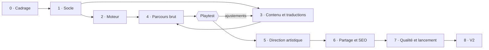

# 03 · Plan de développement

> **Version :** 0.1, brouillon du 15/11/2026, à valider
> **Documents liés :** [01 · Cahier des charges](01-cahier-des-charges.md) · [02 · Questionnaire et impacts](02-questionnaire.md)

Ce plan découpe le projet en **phases courtes**. Chaque phase se termine par un **jalon vérifiable** et une validation de ta part avant de passer à la suivante. Les identifiants entre crochets (`[F-25]`, `[C3]`…) renvoient aux exigences du cahier des charges.

---

## 1. Principes de travail

1. **En ligne dès le premier jour.** Le site est déployé dès la phase 1, puis enrichi à chaque phase. On ne garde jamais une « grosse version » cachée en local.
2. **La logique avant l'habillage.** D'abord le moteur testé, puis le parcours complet sans décor, et la direction artistique en dernier. Si le temps manque, on a toujours un produit qui fonctionne.
3. **Une donnée, une source.** Les deltas vivent dans le code, les textes dans les fichiers de traduction, et la documentation est générée à partir de ces sources.
4. **Tout est mesuré.** Chaque critère du cahier des charges devient, dès que possible, un test automatique.
5. **Rôles.** Claude implémente, teste et documente. Lilian valide chaque jalon, tranche les choix de contenu et de style, et réalise les actions liées à ses comptes (GitHub, Vercel).

### 1.1 Flux Git

- `main` : production. Elle est protégée : aucune fusion sans CI verte.
- Une branche par sujet (`feat/moteur-score`, `feat/i18n`, `fix/…`), fusionnée par pull request. Chaque PR a son déploiement d'aperçu Vercel.
- Messages de commit au format **Conventional Commits** (`feat:`, `fix:`, `docs:`, `test:`, `chore:`…).
- Un tag par phase terminée (`v0.1.0`, `v0.2.0`…) et `v1.0.0` au lancement.

### 1.2 Architecture cible

```
src/
├─ app/[locale]/
│  ├─ layout.tsx · not-found.tsx    Layout racine (html, polices, textes client) ; 404
│  └─ (site)/                   Garde de langue, en-tête et pied de page communs
│     ├─ page.tsx               Accueil (bunker)
│     ├─ quiz/page.tsx          Questionnaire (dossier)
│     ├─ r/[code]/page.tsx      Résultat (PDA), rendu à la demande puis mis en cache
│     ├─ r/[code]/opengraph-image.tsx   Image d'aperçu dynamique (phase 6)
│     ├─ factions/page.tsx
│     ├─ how-it-works/page.tsx
│     └─ about/page.tsx
├─ lib/quiz/                    Moteur (fonctions pures, sans dépendance au navigateur)
│  ├─ domain.ts · types.ts      Axes, factions, échelle, seuils ; types
│  ├─ engine.ts                 Profil, distances, classement, résultat hybride
│  ├─ session.ts                Déroulé d'une partie : réponses, retour arrière, mélange, sauvegarde
│  ├─ encoding.ts               Réponses ↔ code d'URL (version + somme de contrôle)
│  ├─ simulation.ts · random.ts Personas simulées, calibration des centres (graine fixe)
│  ├─ balance.ts                Critères d'équilibrage C1 à C6
│  ├─ fingerprint.ts            Empreinte stable des données
│  └─ schema.ts                 Schémas Zod (tests et validation avant build)
├─ data/
│  ├─ questionnaire.v1.ts       Deltas des 24 questions, sans texte
│  ├─ factions.ts               Profils déclarés des 12 factions
│  ├─ centers.v1.json           Centres calibrés, générés et versionnés
│  ├─ questionnaires.ts         Registre des versions (anciens liens lisibles)
│  ├─ check.ts                  Contrôle de cohérence données + textes
│  └─ index.ts                  resultCode(), resultFromCode()
├─ messages/fr.json · en.json · uk.json · ru.json   Tous les textes
├─ components/
│  ├─ bunker/                   Scène d'accueil, lecteur du fond vidéo
│  ├─ quiz/                     Dossier (client), partie sauvegardée dans le navigateur
│  ├─ result/                   Radar SVG, touches de partage du PDA
│  └─ …                         En-tête et menu, 12 emblèmes, notes de Sidorovich
│                               (design tokens et matières : app/globals.css)
scripts/   calibrate.ts · balance-report.ts · gen-questionnaire-doc.ts · validate-data.ts
tests/     unit/ · property/ · balance/       Vitest
e2e/       quiz.spec.ts · pages.spec.ts         Playwright, sur le build de production
```

**Code de résultat** `[F-25]` : les 24 réponses forment un nombre en base mixte (4 ou 5 possibilités par question, environ 50 bits), écrit en base64url. On ajoute un caractère de version et deux caractères de somme de contrôle, soit **12 caractères**. Exemple : `/fr/r/1AUoEtqwqfeJ`. L'ordre mélangé des réponses à l'écran n'intervient pas : on encode l'indice de la réponse d'origine.

---

## 2. Vue d'ensemble



| Phase | Objectif | Charge estimée* | Jalon | Tag |
|---|---|---|---|---|
| 0 · Cadrage | Les 3 documents et le prototype du moteur | ✅ fait | Documents validés par Lilian | — |
| 1 · Socle | Projet Next.js en 4 langues, CI, déploiement | ✅ fait | « Hello Zone » en production dans les 4 langues | `v0.1.0` |
| 2 · Moteur | Moteur de score en TypeScript, testé et équilibré | ✅ fait | Tests et critères C1 à C6 verts en CI | `v0.2.0` |
| 3 · Contenu | Textes FR définitifs et traductions EN, UK, RU | ✅ fait (relecture native à venir) | 100 % des clés traduites ; lore validé | `v0.3.0` |
| 4 · Parcours brut | Test jouable de bout en bout, sans décor | 2 j | Tests de bout en bout verts ; playtest fait | `v0.4.0` |
| 5 · Direction artistique | Bunker, dossier, PDA, animations | 4 à 5 j | Maquettes respectées ; budgets de performance tenus | `v0.5.0` |
| 6 · Partage et SEO | Images d'aperçu, métadonnées | 1 j | Aperçus validés sur 4 plateformes | `v0.6.0` |
| 7 · Qualité et lancement | Audits, mentions légales, README | 1 à 2 j | Recette du cahier des charges (§ 12) complète | `v1.0.0` |
| 8 · V2 | Statistiques, comparaison, easter egg | 2 à 3 j | Au choix après le lancement | `v1.x` |

\* En jours de travail effectif. Les relectures externes (traductions, lore) et tes validations s'ajoutent au calendrier, sans être du temps de développement.

---

## 3. Détail des phases

### Phase 0 · Cadrage ✅

- [x] Choix structurants : factions, rôle de Sidorovich, modèle de calcul, back-end, direction artistique, longueur.
- [x] Cahier des charges ([01](01-cahier-des-charges.md)).
- [x] Questionnaire v0 avec impacts calculés ([02](02-questionnaire.md)).
- [x] Prototype du moteur et des tests d'équilibrage, tous les critères au vert (porté en TypeScript en phase 2).
- [x] Plan de développement (ce document).
- [x] **Jalon : documents validés** le 15/11/2026 (réponses aux questions ouvertes reportées dans le cahier, § 13.2).

### Phase 1 · Socle technique

**Préalables de ton côté :**
- Vérifier que `git push` fonctionne vers le dépôt (Git Credential Manager est configuré sur ta machine).
- Créer le projet Vercel en important le dépôt GitHub (Q-A : adresse `*.vercel.app`).

**Tâches :**
- [x] Relier le dossier local au dépôt `LilianBrossard/Sidorovich` ; ajouter `.gitignore`, `.gitattributes` (fins de ligne LF), `README` minimal et `LICENSE` MIT (Q-D).
- [x] Initialiser Next.js 16.4 (TypeScript strict, App Router, Cache Components, dossier `src/`, Tailwind 4, ESLint) et ajouter Prettier.
- [x] Installer `next-intl` 4 avec `next/root-params` : routage `/fr` `/en` `/uk` `/ru`, détection `Accept-Language` à la racine (repli sur l'anglais), choix mémorisé par cookie, en-têtes `hreflang`, sélecteur de langue `[I-01] [I-02] [I-06] [I-08]`.
- [x] Charger les polices latin + cyrillique via `next/font` : *PT Sans* (texte), *PT Mono* (dossier), *IBM Plex Mono* (PDA) ; page de contrôle `/fr/typography` `[I-04]`.
- [x] Créer l'accueil provisoire dans les 4 langues, le pied de page avec l'avertissement fan et la 404 localisée, y compris pour les URL du type `/fichier.txt` `[F-01] [F-03] [F-33] [L-01] [N-07]`.
- [x] Ajouter le test de complétude des traductions `[I-03]`.
- [x] Mettre en place GitHub Actions : lint, format, types, tests, équilibrage C1 à C6, build `[T-09] [T-10]`.
- [ ] Protéger `main` dans les réglages GitHub (Settings → Branches : PR obligatoire, vérification « CI » requise). **À faire par Lilian.**
- [x] Brancher Vercel : import du dépôt, aperçu par PR, production sur `main` (https://sidorovich.vercel.app).

**Fini quand :** l'URL de production affiche une page dans les 4 langues, la CI est verte et une PR de test a généré son aperçu.

### Phase 2 · Moteur de score (développé en TDD) ✅

- [x] Porter le prototype en TypeScript dans `src/lib/quiz/` et `src/data/`. Les deltas restent dans le code ; les textes français sont dans `messages/fr.json`. Le portage est exact : les centres calibrés sont identiques à ceux du prototype, à la 4e décimale.
- [x] Écrire les schémas Zod et `npm run validate`, lancé automatiquement avant chaque build : une donnée invalide, un texte manquant ou des centres périmés font échouer le build `[S-02]`.
- [x] Écrire `engine.ts` : `computeProfile()`, `rankFactions()`, `compatibility()`, `evaluate()` avec détection du résultat hybride `[S-01] [F-24]`.
- [x] Écrire `encoding.ts` : codes de 12 caractères, version et somme de contrôle modulo 4093, qui détecte toute faute de frappe sur un caractère et toute inversion de deux voisins ; erreurs typées, jamais d'exception `[F-25] [F-26]`.
- [x] Écrire `npm run calibrate` : graine fixe, sortie `centers.v1.json` versionnée avec l'empreinte de ses entrées `[S-03]`.
- [x] Tests unitaires : cas connus, bornes, déterminisme, codes de non-régression `[S-05]`.
- [x] Tests de propriétés (fast-check) : `décoder(encoder(x)) = x`, profil toujours dans [−1, 1]⁷, classement toujours de 12 factions, décodage sans exception.
- [x] Tests d'équilibrage C1 à C6, exécutés en CI `[5.3]`.
- [x] Empreinte des versions publiées du questionnaire `[S-04]` : mécanisme en place ; v1 sera figée au lancement.
- [x] Remplacer `docs/prototype/` par `scripts/gen-questionnaire-doc.ts`, qui lit `src/data` et `messages/fr.json`.

**Fini quand :** `npm test` est vert, la couverture du moteur atteint au moins 90 % et le document 02 se régénère depuis le code.

### Phase 3 · Contenu et traductions ✅

- [x] Intégrer tes retours sur le document 02 : aucun retour pour l'instant ; les questions restent celles de la v1.
- [x] Traiter les points faibles connus. Seuls les **profils déclarés** de trois factions ont été ajustés, sans toucher aux questions : Ward plus pragmatique, Clear Sky plus rationnelle et plus soudée, Noon qui rejette l'obéissance aveugle et croit à la seconde chance. Reconnaissance minimale : 65,5 % → 70,2 % ; Ward : 72,5 % → 81,1 %.
- [x] Rédiger les fiches des 12 factions (description de 2 à 3 phrases) et les explications par axe, avec des seuils testés `[F-23] [F-30] [N-06]`. Les textes d'interface du parcours sont écrits avec l'interface, en phase 4.
- [x] Faire la relecture lore de Ward, Spark et Noon `[13.2]`. Noon : anciens du Monolithe libérés de leur endoctrinement, « seconde chance » (Strider). Noms russes Варта et Полдень confirmés. En français, la Ward serait « la Garde » dans la VF (une seule source) : le nom anglais est conservé en attendant une confirmation.
- [x] Traduire en EN, UK et RU à partir du glossaire (cahier, § 7) : 273 textes par langue. En ukrainien et en russe, les réponses sont au présent et l'échelle d'accord évite les adjectifs genrés (« Скорее да », « Скоріше ні »).
- [x] Ajouter le test de complétude des traductions, sans exception désormais `[I-03]`.
- [ ] Faire relire UK et RU par des locuteurs natifs `[I-07]` (Q-B : plus tard, par Lilian).
- [x] Relire les contenus sensibles : rien de politique ou de religieux réel ; formulations épicènes `[N-03] [N-04]`.

### Phase 4 · Parcours fonctionnel brut

Un design volontairement minimal : on valide le fonctionnement avant de l'habiller.

- [x] Créer les pages accueil, questionnaire, résultat, factions, « Comment ça marche », « À propos » et 404 `[F-01] [F-30…F-33]`. En-tête commun avec lien d'évitement, navigation et langues. Chaque fiche de faction mène à son « dossier type ».
- [x] Gérer l'état du questionnaire : un réducteur pur (`lib/quiz/session.ts`, testé sans navigateur) et une partie sauvegardée dans `localStorage`, lue avec `useSyncExternalStore`. Mélange des réponses par graine (les échelles d'accord ne sont jamais mélangées), retour arrière, reprise, « Recommencer » avec confirmation `[F-11] [F-13] [F-14]`.
- [x] Gérer le clavier et la progression : touches 1 à 4 (ou 5), ← →, ↑ ↓ entre les réponses, Retour arrière ; focus replacé sur l'intitulé à chaque question `[F-12] [F-15]`.
- [x] Afficher les répliques de Sidorovich : accueil, 8 réactions, mi-parcours, calcul ; effet de frappe qu'un clic passe, désactivé avec `prefers-reduced-motion` `[F-16] [V-06]`.
- [x] Construire la page résultat : faction, %, verdict, description, radar SVG avec tableau pour les lecteurs d'écran, 7 explications par axe, classement des 12, cas hybride `[F-20…F-24]`. Page statique : les 12 dossiers types sont pré-rendus, tout autre code est rendu à sa première visite puis servi depuis le cache (`ensureStatic = "navigation"`) `[T-01]`. Non indexée.
- [x] Ajouter le partage natif et la copie du lien `[F-27]`.
- [x] Écrire les tests Playwright (17 scénarios, chacun sur ordinateur et sur mobile) : parcours complet dans les 4 langues ; lien partagé rouvert dans un nouveau contexte ; codes invalide, altéré et tronqué ; résultat hybride ; retour arrière ; reprise ; changement de langue ; clavier ; 404 ; bouton visible en 360 × 640 ; aucun défilement horizontal à 360 px. Ajoutés à la CI.
- [ ] **Playtest avec 10 à 20 personnes** : durée, réactions, résultat jugé juste ou non (note sur 5). Retour en phase 3 si besoin. Protocole et grille : [document 04](04-playtest.md).

À savoir : avec `cacheComponents`, Next.js garde les pages quittées dans le DOM, masquées (composant `Activity`). Deux langues d'une même page peuvent donc coexister. Les identifiants référencés par ARIA sont uniques (`useId`) et les tests ne visent que les éléments visibles.

Mesures : 158 Ko de JavaScript compressé sur la page questionnaire (budget : 200 Ko) `[T-05]`.

**Fini quand :** le test est jouable de bout en bout en production, les tests de bout en bout sont verts et la synthèse du playtest est écrite.

### Phase 5 · Direction artistique

- [x] Préparer un moodboard (planche d'ambiance), puis **6 maquettes** : 3 scènes × mobile et ordinateur. **Tu les valides avant l'intégration** `[V-04]`. Validées le 15 novembre 2026, avec une demande : un fond vidéo en boucle pour Sidorovich au lieu du SVG. Détails : [document 05](05-direction-artistique.md).
- [x] Créer les design tokens et les composants de base : papier, tampon, case à cocher, écran PDA, boutons `[V-01] [V-02]`. Matières en CSS, sans image.
- [ ] **Bunker** : lampe qui vacille et bulle de dialogue faites ; le lecteur du fond vidéo est prêt (pause, économie de données, animations réduites). **Reste la vidéo, fournie par Lilian** (cahier des charges et prompt : document 05).
- [x] **Dossier** : feuillets, 24 cases de progression, cases cochées, notes trombonées de Sidorovich, tampon « Dossier complet », feuillet glissé à chaque question.
- [x] **PDA** : coque et écran à phosphore, démarrage bloc par bloc, radar tracé à l'écran, curseurs par axe, 12 emblèmes SVG originaux `[V-03]`.
- [x] Animations en CSS plutôt qu'avec Motion (aucun JavaScript en plus), `prefers-reduced-motion` respecté `[V-05] [V-06]`. Les 60 images par seconde restent à mesurer sur un téléphone.
- [x] Responsive de 360 px à 1920 px, vérifié par les tests de bout en bout (360, 768, 1280, 1920 px) `[V-07]`. Menu repliable sur mobile.
- [ ] (Souhaitable) Ambiance sonore coupée par défaut `[F-40]`.
- [ ] Contrôler les budgets `[T-03…T-05]` : JavaScript mesuré (161 Ko compressés sur le questionnaire, 164 Ko sur le résultat, pour 200 Ko autorisés) ; Lighthouse en phase 7.

**Fini quand :** les maquettes sont respectées, les seuils de performance et d'accessibilité sont tenus et le rendu est vérifié sur un vrai téléphone.

### Phase 6 · Partage et SEO

- [ ] Générer les images d'aperçu par résultat et par langue (`opengraph-image.tsx`) `[F-28]`.
- [ ] Ajouter les métadonnées par page et par langue, `hreflang`, `sitemap.xml`, `robots.txt`, icônes et manifest `[T-08] [I-06]`.
- [ ] Vérifier les aperçus dans les outils de Discord, X, Facebook et LinkedIn.
- [ ] Trancher le nom et le domaine (question Q-A).

**Fini quand :** un lien de résultat collé sur les 4 plateformes affiche le bon aperçu, dans la bonne langue.

### Phase 7 · Qualité et lancement

- [ ] Audit d'accessibilité : axe-core automatisé, parcours au clavier, NVDA et VoiceOver `[T-06]`.
- [ ] Lighthouse sur les 3 pages clés, sur mobile ; Core Web Vitals `[T-03] [T-04]`.
- [ ] Tests multi-navigateurs et sur appareils réels `[T-07]`.
- [ ] En-têtes de sécurité, Dependabot, `npm audit` `[T-11]`.
- [ ] Mentions légales, crédits, avertissement fan, licence ; vérification des conditions de GSC Game World `[L-01…L-06]`.
- [ ] (Souhaitable) Vercel Web Analytics `[T-12]`.
- [ ] README portfolio : capture animée, schéma d'architecture, explication du moteur, indicateurs d'équilibrage, scores Lighthouse.
- [ ] Dérouler la checklist de recette du cahier des charges (§ 12) ; tag `v1.0.0`.

**Fini quand :** tous les points de la recette sont cochés.

### Phase 8 · V2 (optionnelle, après le lancement)

- [ ] **Statistiques globales** `[F-42]` : Upstash Redis via la Vercel Marketplace, route `POST /api/results` qui reçoit seulement le code, un compteur par faction, limitation de débit (`@upstash/ratelimit`), dédoublonnage, page `/stats`, politique de confidentialité `[L-04]`.
- [ ] **Comparaison de deux résultats** `[F-43]` : `/compare/{code1}/{code2}`, radars superposés.
- [ ] **Easter egg** `[F-41]`.
- [ ] Recalibrer le modèle à partir des statistiques réelles. Les simulations sont alors confrontées aux vrais répondants.

---

## 4. Risques

| Risque | Impact | Parade |
|---|---|---|
| Idéologie de Ward, Spark ou Noon mal interprétée | Joueurs déçus, crédibilité | Relecture lore en phase 3 ; les profils restent faciles à ajuster grâce au document 02 généré. |
| Traductions UK et RU de qualité insuffisante | Image négative auprès d'une partie importante du public | Relecture native ; à défaut, mention de traduction assistée `[I-07]`. |
| Équilibrage réel différent de la simulation | Résultats jugés injustes | Playtest en phase 4 ; recalibrage par les statistiques en V2. |
| Droits sur les visuels | Retrait du site | Aucun asset officiel ; silhouette plutôt que portrait ; emblèmes originaux `[L-02] [V-03]`. |
| Animations trop lourdes sur mobile | Performance sous le seuil | Budgets contrôlés à chaque PR ; animations CSS et SVG d'abord ; réduction des animations respectée. |
| Polices cyrilliques peu adaptées au style | Rendu incohérent selon la langue | Choix et test des polices dès la phase 1. |
| Ajouts au fil de l'eau | Le lancement recule | Priorités MoSCoW ; tout ajout passe par le cahier des charges ; la V2 est séparée. |
| Production des illustrations plus lente que prévu | Phase 5 qui déborde | Style volontairement graphique (SVG et CSS, silhouettes) ; question Q-C tranchée tôt. |

---

## 5. Prochaines actions

1. **Toi :** relire les documents [01](01-cahier-des-charges.md), [02](02-questionnaire.md) et [03](03-plan-de-developpement.md), puis répondre aux questions ouvertes Q-A à Q-E (cahier, § 13.2), au moins Q-B et Q-C, qui pèsent le plus sur le calendrier.
2. **Toi :** `gh auth login`, ou vérifier l'accès en écriture au dépôt, puis créer le projet Vercel lié au dépôt.
3. **Claude :** démarrer la phase 1 dès ta validation.
